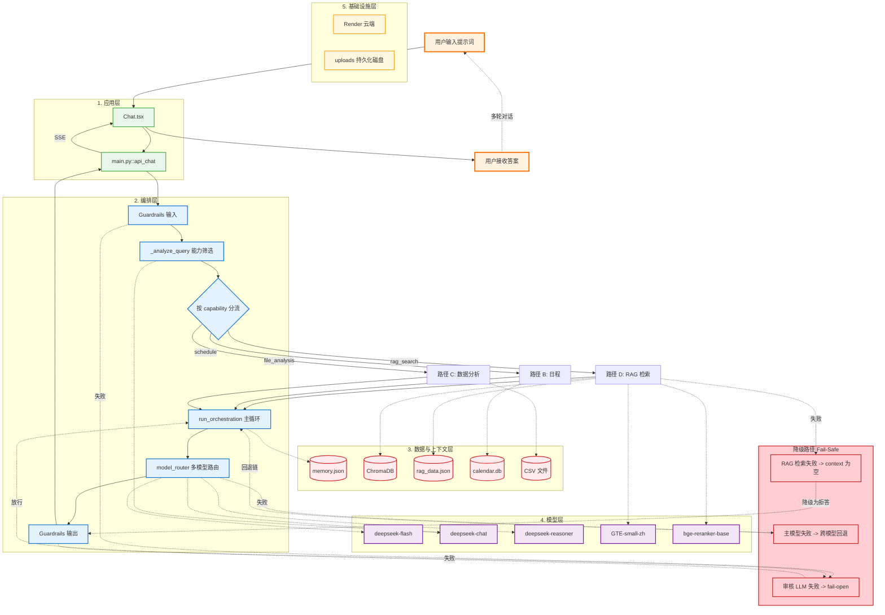
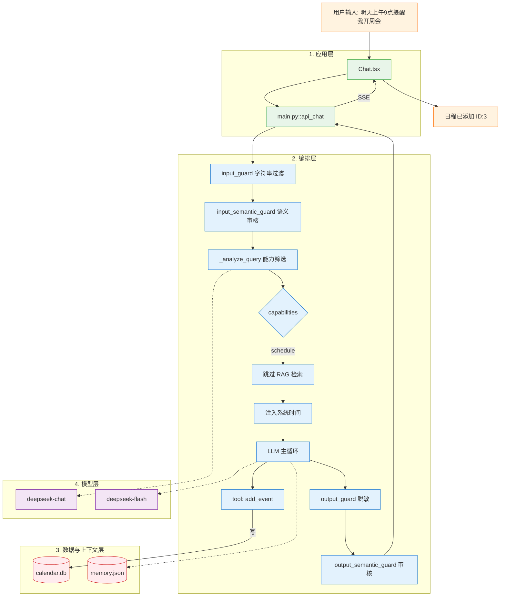
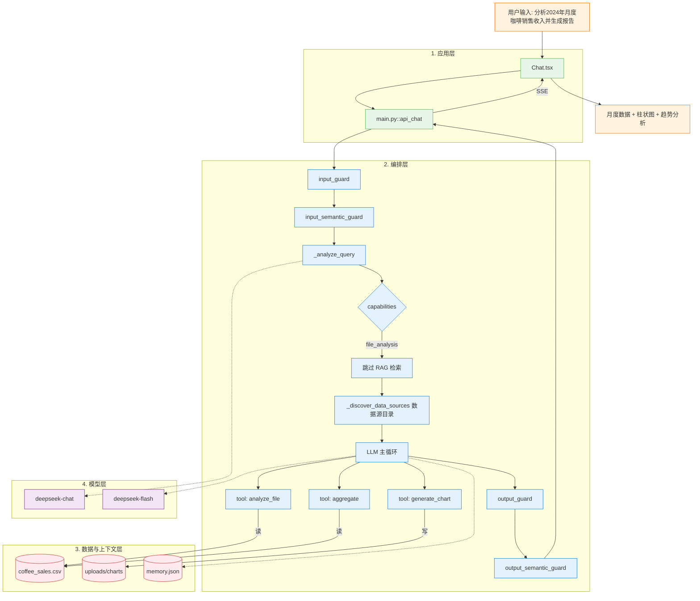
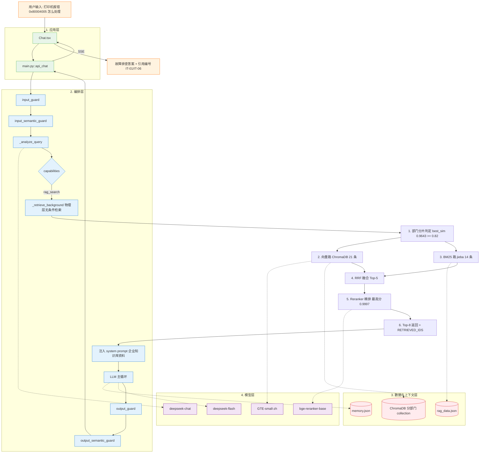
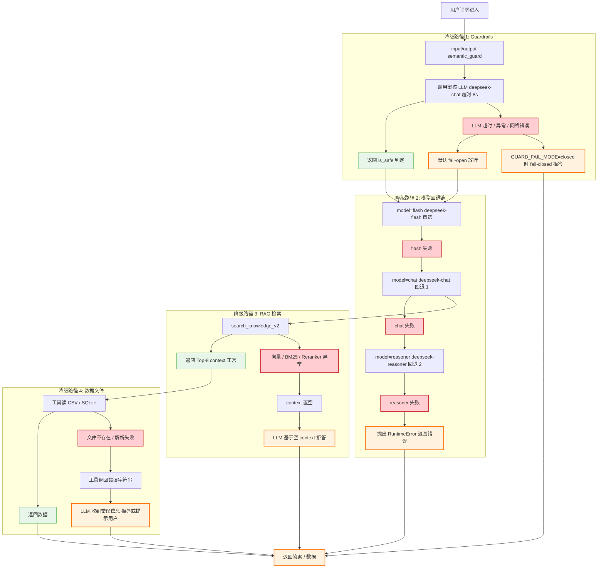

# RAG 架构与逻辑流程

> 版本：v3.0.0
> 日期：2026-10-14
> 目的：以 AI Native 五层架构为标尺，可视化 RAG 在系统中的位置、数据流、请求路径与降级路径
> 维护者：产品负责人 + 开发团队
> 关联文档：`docs/AI_NATIVE_ARCHITECTURE.md`、`docs/CONTRACT.md`

---

## 一、文档目的与读者

本文档回答三个问题：

1. **RAG 在 AI 原生系统五层架构中的位置是什么？**
2. **用户不同输入触发哪些路径？哪些走 RAG 检索，哪些不走？**
3. **每一环失败时降级到哪里？**

读者：开发工程师、架构评审人、新加入成员。

---

## 二、RAG 在 AI 原生系统五层架构中的位置

| 层级 | RAG 相关组件 | 代码位置 |
|---|---|---|
| 应用层 | 知识库管理界面、上传接口、聊天界面 | `Chat.tsx` / `main.py::api_kb_*` |
| 编排层 | 物理层无条件检索、工具包装、输出后处理 | `orchestrator.py` / `tools.py` |
| **数据与上下文层** | **向量库、BM25、RRF、Reranker、元数据** | **`rag_v2.py`** |
| 模型层 | GTE-small-zh 向量模型、bge-reranker-base 精排模型 | `rag_v2.py` |
| 基础设施层 | ChromaDB 持久化、模型缓存、Render 磁盘 | `uploads/` |

**核心定位**：RAG 是**数据与上下文层**的核心实现，向上被**编排层**调用，向下依赖**模型层**的向量与精排模型。

---

## 三、总览图（五层架构 + 闭环 + 降级路径）

**图读法**：

- 五层架构自上而下穿过，每个 subgraph 对应一层
- 实线：主流程，从"用户输入"到"用户接收答案"
- 虚线 `.->.`：数据读写 / 模型调用 / 多轮对话闭环
- 红色虚线：降级路径，任何环节失败均有兜底

**核心洞察**：三类用户输入触发**三条不同路径**，只有 `rag_search` 会真正走 ChromaDB 检索。

| 用户输入类型 | capabilities | 是否走 RAG 检索 |
|---|---|---|
| 日程类 | `['schedule']` | 否 |
| 数据分析类 | `['file_analysis']` | 否 |
| 知识问答类 | `['rag_search']` | **是** |

---

## 四、单路径详图

### 4.1 路径 B：日程（不走 RAG）

**典型输入**：`明天上午9点提醒我开周会`

**关键点**：

- `capabilities=['schedule']` → **跳过 `_retrieve_background`**
- 注入系统时间，让 LLM 知道"明天"是哪天
- 一次工具调用 `add_event`，写入 `calendar.db`

### 4.2 路径 C：数据分析（不走 RAG 检索）

**典型输入**：`分析2024年月度咖啡销售收入并生成报告`

**关键点**：

- `capabilities=['file_analysis']` → **跳过 `_retrieve_background`**
- 注入数据源目录，告诉 LLM 有 `coffee_sales.csv`
- 工具链：`analyze_file` → `aggregate` → `generate_chart`
- 输出含图片 URL，由 `output_guard` 保护不被脱敏（US-14.1）

### 4.3 路径 D：RAG 检索（唯一走 ChromaDB 的路径）

**典型输入**：`打印机报错 0x80004005 怎么处理`

**关键点**：

- **唯一走 ChromaDB 的路径**
- **物理层无条件检索**（v2.5.0 起）：不依赖 LLM 决策，保证 context 一定注入
- **6 步检索链**：部门分片 → 向量 + BM25 → RRF → Reranker → Top-8 → 注入 prompt
- **`[RETRIEVED_IDS]` 结构化标记**：供后端可靠提取真实命中 ID

---

## 五、降级路径单图（Fail-Safe 全景）

**四条降级路径对照表**：

| # | 触发条件 | 降级行为 | 代码位置 |
|---|---|---|---|
| 1 | 审核 LLM 超时 / 异常 | fail-open 放行 / fail-closed 拒答 | `guardrails.py::_semantic_judge` |
| 2 | 主模型失败 | flash → chat → reasoner → 报错 | `model_router.py::call_with_fallback` |
| 3 | RAG 检索异常 | context 置空，LLM 拒答 | `orchestrator.py::_retrieve_background` |
| 4 | 数据文件读取失败 | 工具返回错误字符串，LLM 转述 | `tools.py::analyze_file` / `aggregate` |

---

## 六、RAG 与 AI 系统交互时序图

```mermaid
sequenceDiagram
    autonumber
    participant U as 用户
    participant F as 前端 Chat.tsx
    participant M as main.py
    participant O as orchestrator.py
    participant G as guardrails.py
    participant R as rag_v2.py
    participant L as LLM DeepSeek
    participant T as tools.py

    U->>F: 输入 query
    F->>M: POST /api/chat (SSE)
    M->>M: 用户状态校验
    M->>O: run_orchestration(session_id, query)

    Note over O: 1 前置管道
    O->>G: input_guard 字符串级
    O->>G: input_semantic_guard LLM 语义审核
    G-->>O: safe / block

    Note over O: 2 语义分析
    O->>L: _analyze_query
    L-->>O: capabilities, specified_format, task_nature

    Note over O,R: 3 物理层无条件检索
    alt capabilities 含 rag_search
        O->>R: _retrieve_background(query)
        R->>R: search_knowledge_v2
        R-->>O: context_text, sources, ids
        O->>O: 注入 system prompt
    end

    Note over O,L: 4 LLM 主循环 最多 8 轮
    loop iteration < 8
        O->>L: chat.completions.create
        L-->>O: tool_calls 或 answer
        alt 有 tool_calls
            O->>T: 执行工具
            T-->>O: 工具结果
            O->>L: 回灌结果
        else 无 tool_calls
            Note over O: 退出循环
        end
    end

    Note over O,G: 5 后处理
    O->>G: output_guard 字符串脱敏
    O->>G: output_semantic_guard LLM 语义审核
    O->>O: 图片处理 + source_prefix

    O-->>M: SSE chunk
    M-->>F: data: ...
    F-->>U: 打字机渲染
```

---

## 七、每层职责与代码文件映射表

| 层 | 职责 | 代码文件 | 关键函数 |
|---|---|---|---|
| 应用层 | 用户界面、API 端点 | `frontend/src/pages/Chat.tsx`、`common/main.py` | `api_chat` / `api_kb_index` |
| 编排层 | 安全过滤、能力筛选、检索调用、主循环 | `common/orchestrator.py`、`common/tools.py`、`common/guardrails.py`、`common/model_router.py` | `run_orchestration` / `_retrieve_background` / `call_with_fallback` |
| 数据与上下文层 | 检索、融合、精排、记忆 | `common/rag_v2.py`、`common/memory.py` | `search_knowledge_v2` / `index_document_v2` |
| 模型层 | 向量化、精排、LLM | `common/rag_v2.py`（模型加载）、`common/orchestrator.py`（LLM 调用） | GTE-small-zh / bge-reranker-base / DeepSeek |
| 基础设施层 | 持久化、部署 | `uploads/`、`start.sh`、`.github/workflows/deploy.yml` | ChromaDB / Render Disk |

---

## 八、术语表

| 术语 | 含义 |
|---|---|
| **RRF** | Reciprocal Rank Fusion，将多路检索结果按排名倒数融合 |
| **Reranker** | Cross-Encoder 精排模型，对 RRF 候选池二次打分 |
| **物理层无条件检索** | v2.5.0 起设计，不依赖 LLM 决策，主流程开始即执行 |
| **部门分片** | 按部门分 ChromaDB collection，检索时先算 best_sim 选片 |
| **`[RETRIEVED_IDS]`** | 结构化标记，后端可靠提取真实命中文档 ID |
| **fail-open** | 审核服务失败时放行，保证可用性 |
| **fail-closed** | 审核服务失败时拒绝，保证安全性 |
| **capabilities** | `_analyze_query` 输出的能力候选列表，如 `['rag_search']` |

---

## 九、版本历史

| 版本 | 日期 | 变更 |
|---|---|---|
| v3.0.0 | 2026-10-14 | 首版定稿：总览图 + 3 路径详图 + 降级路径图 + 时序图 |